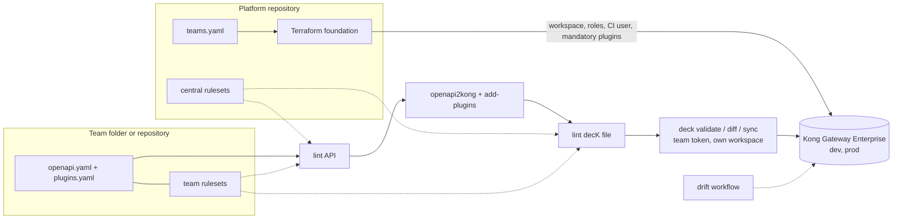

# Federated APIOps for Kong Gateway Enterprise

A production-style APIOps setup for **Kong Gateway Enterprise 3.16** where a **platform team** owns
the gateway and **API teams** ship their own APIs from an OpenAPI spec, without being able to touch
each other or the platform's rules. The pipelines are GitHub Actions workflows made of plain
`deck` and `terraform` commands; there are no pipeline scripts to maintain.

| Layer | Owned by | Tool | What it manages |
|---|---|---|---|
| Bootstrap (once) | Platform | `platform/bootstrap` | the platform pipeline's own RBAC user, before entity-level RBAC is enforced |
| Foundation | Platform | Terraform ([kong-gateway provider](https://registry.terraform.io/providers/kong/kong-gateway/latest)) | one workspace per team, roles and entity permissions, each team pipeline's RBAC user, the **mandatory plugins** |
| Rulesets | Platform and teams | `deck file lint` | central rules every team passes; each team's own extra rules |
| APIs | Each team | decK | OpenAPI spec → services, routes, the team's own plugins and consumers |



## What each requirement turns into

| Requirement | How it's enforced | Proven by `make test` |
|---|---|---|
| The platform owns mandatory plugins and teams can't modify them | Terraform creates them as global plugins in every team workspace, tagged `platform`. With `enforce_rbac = both`, the team role is denied update and delete on each one. The central platform ruleset blocks a team from reusing a mandatory plugin's name on its services or routes (which would replace it), from global plugins and from `ordering`. | team PUT and DELETE on each mandatory plugin → 403, the platform's PUT on the same plugin → 200, the rogue team's plugins rejected by the ci workflow |
| Teams can only deploy their OAS with their allowed plugins | The team pipeline builds the decK file from the spec and `plugins.yaml` and lints it with the central rulesets, the platform's rules for that team (path prefix) and the team's own rules | the ci workflow: both teams pass, the rogue spec and plugins fail |
| Existing clients don't break by surprise | On pull requests, [oasdiff](https://github.com/oasdiff/oasdiff) compares the spec with the base branch: a breaking change without a new major `info.version` fails (`--fail-on MISSING-VERSION-BUMP`) | the ci workflow: a removed operation with a minor bump fails, with a major bump passes |
| Teams can't do anything in workspaces that aren't theirs | Each team pipeline's RBAC user has a role only in the team's workspace, denied `/rbac`, `/workspaces` and `/vaults` | reads and writes in the other workspace → 403, creating users, roles or workspaces → 403 |
| One repository or many | One reusable team pipeline: `teams.yaml` calls it for each team folder here, a team's own repository calls it at a pinned version (`examples/team-repo`) | the monorepo path end to end; the team-repository path is not run end to end (it needs two GitHub repositories) |
| Nothing changes outside the pipelines | The drift workflow: `terraform plan -detailed-exitcode` for the platform; per team `deck gateway diff --non-zero-exit-code` and a lint of a workspace dump with the team's ownership rule | a hand edit, a plugin added by hand, a switched-off and a deleted mandatory plugin each fail the drift workflow, and the platform or teams workflow repairs them |

## Try it

Needs Docker, [mise](https://mise.jdx.dev) and a Kong Gateway Enterprise license (workspaces and
RBAC are Enterprise features). The license is read from `~/.kong-license-data/license.json`, or set
`KONG_LICENSE_FILE`. Run the commands from the repository root:

```bash
mise install      # decK 1.70.1, Terraform 1.17.2, act, yq, linters (pinned in mise.toml)
make up           # dev and prod Kong, the bootstrap, then the platform and teams workflows
make test         # every rule above, including the attempts that must fail
make down         # stop the containers, keep the data
make clean        # remove everything this repository created
```

`make up` runs Kong in Docker on 127.0.0.1 and runs this repository's GitHub workflows locally with
[act](https://github.com/nektos/act) against both environments. The lab proxy uses Kong's default
self-signed certificate.

| | Proxy | Admin API | Kong Manager |
|---|---|---|---|
| dev | https://127.0.0.1:18443 | http://127.0.0.1:18001 | http://127.0.0.1:18002 |
| prod | https://127.0.0.1:19443 | http://127.0.0.1:19001 | http://127.0.0.1:19002 |

Log in to Kong Manager as `kong_admin` with the `KONG_ADMIN_TOKEN` value from `.env` (created by
`make up`, never committed). In production, map Kong Manager to your identity provider and give
each team's people the read-only `apiops-viewer` role.

## Repository layout

```text
teams.yaml                         team registry (platform-owned): one workspace per team
platform/bootstrap/                one-time, by a person: the platform pipeline's RBAC user
platform/foundation/               Terraform: workspaces, RBAC, entity rules, mandatory plugins
platform/governance/               central rulesets: api-rules, kong-rules, teams/<team>.yaml
teams/<team>/                      openapi.yaml, plugins.yaml, consumers.yaml, rules/ (team-owned)
.github/workflows/team-pipeline.yaml   the reusable team pipeline (lint, plan, deploy, drift)
.github/actions/build-team/        lint the spec, build the decK file, lint it (both jobs use it)
.github/actions/breaking-change/   oasdiff: breaking changes need a new major version (pull requests)
.github/workflows/teams.yaml       one repository for all teams: runs the pipeline per team
.github/workflows/platform.yaml    Terraform plan and apply, dev then prod
.github/workflows/drift.yaml       scheduled drift check for the platform and every team
.github/workflows/ci.yaml          this repository's own checks (no Kong needed)
examples/team-repo/                a team's own repository calling the reusable pipeline
lab/                               Docker Compose lab (dev and prod) and its runner
tests/                             make test and the rogue fixtures
```

## Adopt it

1. List your teams in `teams.yaml`, add `platform/governance/teams/<team>.yaml` for each, set your
   mandatory plugins in `platform/foundation/mandatory-plugins.tf` and the allowed list in
   `platform/governance/kong-rules.yaml`.
2. Per environment, once: start Kong with `enforce_rbac = on`, run `platform/bootstrap`
   ([README](platform/bootstrap/README.md)), switch to `enforce_rbac = both`.
3. Configure a remote Terraform backend (the lab uses the `pg` backend), then set the GitHub
   variables and secrets listed at the top of each workflow. Protect the `prod` environment with
   reviewers and use a runner that can reach the Admin API (`vars.KONG_RUNNER`).
4. Run the platform workflow, then store each team's token from `terraform output ci_tokens` as
   `KONG_TOKEN_<TEAM>_<ENV>`.
5. Teams add a folder under `teams/` (one repository) or copy `examples/team-repo` (one repository
   per team). [docs/federation-model.md](docs/federation-model.md) helps you choose.

## Not covered

Konnect (control planes and teams replace workspaces there), Kong Manager single sign-on mapping,
the Dev Portal, certificates and upstream mTLS, Kong Operator, and other CI systems (the workflows
are plain `deck` and `terraform` commands, so they port). CI on GitHub runs the offline checks;
everything that needs Kong is proven by `make test`.

## Versions

Kong Gateway Enterprise 3.16.0.3, decK 1.70.1, Terraform 1.17.2 with kong/kong-gateway provider
1.4.1, Postgres 18.1, act 0.2.98, oasdiff 1.38.0. Images and actions are pinned by digest or commit.

## License

Apache-2.0
