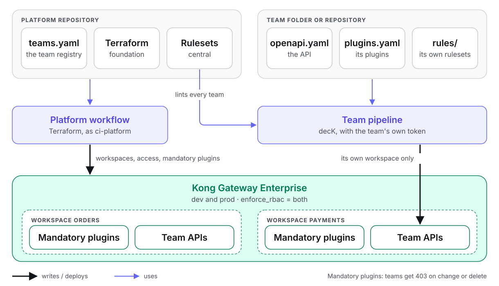

# Federated APIOps for Kong Gateway Enterprise

A platform team owns Kong Gateway Enterprise 3.16. API teams ship their own APIs from an OpenAPI
spec. Nobody can touch another team's workspace or the platform's mandatory plugins.



## What you get

| Rule | Enforced by |
|---|---|
| Teams can't change or delete mandatory plugins | Terraform creates them; entity-level RBAC denies teams (`403`) |
| Teams deploy only their spec and allowed plugins | `deck file lint`: central rulesets plus each team's own |
| A breaking API change needs a new major version | `oasdiff` on pull requests |
| Teams stay in their own workspace | one workspace and one pipeline RBAC user (token) per team |
| People can look but not change anything in Kong Manager | a read-only `<team>-developers` group per team, for your IdP to map to |
| Nothing changes outside Git | a drift workflow every weekday morning |

`make test` proves each rule, including the attempts that must fail.

## Try it

Needs Docker, [mise](https://mise.jdx.dev) and a Kong Gateway Enterprise license at
`~/.kong-license-data/license.json` (or set `KONG_LICENSE_FILE`).

```bash
mise install
make up      # dev and prod Kong, then this repo's workflows, run locally with act
make test    # break every rule on purpose
make down    # stop, keep the data
make clean   # remove everything
```

| | Proxy | Admin API | Kong Manager |
|---|---|---|---|
| dev | https://127.0.0.1:18443 | http://127.0.0.1:18001 | http://127.0.0.1:18002 |
| prod | https://127.0.0.1:19443 | http://127.0.0.1:19001 | http://127.0.0.1:19002 |

Kong Manager login: `kong_admin`, password `KONG_ADMIN_TOKEN` from `.env`.
To run one workflow again: `lab/lab.sh act <workflow>.yaml`; a team's token: `lab/lab.sh token dev <team>`.

## What's where

```text
teams.yaml               the teams (platform-owned)
platform/bootstrap/      one-time setup (the bootstrap workflow): the platform pipeline's RBAC user
platform/foundation/     Terraform: workspaces, RBAC, mandatory plugins
platform/governance/     central rulesets
teams/<team>/            openapi.yaml, plugins.yaml, consumers.yaml, rules/, environments/
.github/workflows/       bootstrap (once), platform, team-pipeline (reusable), teams, drift, ci
examples/team-repo/      a team with its own repository
```

## Use it

1. List your teams in `teams.yaml`; set your mandatory plugins and allowed plugin list.
2. Bootstrap each environment once: [platform/bootstrap](platform/bootstrap/README.md).
3. Set the GitHub variables and secrets named at the top of each workflow.
4. Teams add `teams/<team>/`, or copy `examples/team-repo` for their own repository.

More: [the model and the choices](docs/federation-model.md) ·
[running it in production](docs/production.md)

## Versions

Kong Gateway Enterprise 3.16.0.3 · decK 1.70.1 · Terraform 1.17.2, kong-gateway provider 1.4.1 ·
oasdiff 1.38.0 · act 0.2.98. Everything is pinned by version, digest or commit.

Not covered: Konnect, Kong Manager SSO, Dev Portal, Kong Operator.

Apache-2.0
