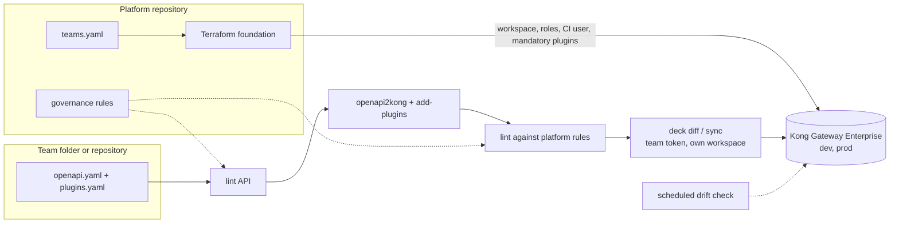

# Federated APIOps for Kong Gateway Enterprise

A production-style APIOps setup for **Kong Gateway Enterprise 3.16** where a **platform team** owns
the gateway and **API teams** ship their own APIs from an OpenAPI spec, without being able to touch
each other or the platform's rules.

| Layer | Owned by | Tool | What it manages |
|---|---|---|---|
| Foundation | Platform | Terraform ([kong-gateway provider](https://registry.terraform.io/providers/kong/kong-gateway/latest)) | One workspace per team, roles, the pipeline's RBAC users, the **mandatory plugins** |
| Guardrails | Platform | `pipelines/protect.sh`, lint rules | Entity rules that stop teams changing mandatory plugins; the rules every team file must pass |
| APIs | Each team | decK | OpenAPI spec → services, routes, the team's own plugins and consumers |



## What each requirement turns into

| Requirement | How it's enforced | Proven by (`make test`) |
|---|---|---|
| The platform owns mandatory plugins and teams can't modify them | Terraform creates them as global plugins in every team workspace, tagged `platform`. With `enforce_rbac = both`, the team role is denied update and delete on each one. The lint rules block a team from reusing a mandatory plugin's name on its own services or routes (which would replace it) and from adding global plugins or `ordering`. | team PUT and DELETE on each mandatory plugin → 403, the platform's PUT on the same plugin → 200, rogue plugins rejected by lint |
| Teams can only deploy their OAS with their allowed plugins | The team pipeline builds the decK file from the spec and `plugins.yaml`, then lints it against the platform's allowed-plugin list and the team's path prefix from `teams.yaml` | rogue spec and plugins fail lint with the reason |
| Teams can't do anything in workspaces that aren't theirs | Each team's pipeline token belongs to an RBAC user whose role lives in the team's workspace and is denied `/rbac`, `/workspaces` and `/vaults` | reads and writes in the other workspace → 403, decK sync into it fails, creating users, roles or workspaces → 403 |
| One repository or many | The team pipeline is one reusable workflow; `teams.yaml` runs it per team folder here, and a team's own repository calls it at a pinned version | the same team folder deploys with no changes from a separate directory |
| Nothing changes outside the pipelines | Daily drift job: `terraform plan -detailed-exitcode` for the platform, `deck gateway diff --non-zero-exit-code` plus an unmanaged-entity check per team | a hand edit, a plugin added by hand and a disabled mandatory plugin each fail the drift job |

## Try it

Needs Docker, [mise](https://mise.jdx.dev) and a Kong Gateway Enterprise license (workspaces and
RBAC are Enterprise features). The license is read from `~/.kong-license-data/license.json`, or set
`KONG_LICENSE_FILE`. Run the commands from the repository root:

```bash
mise install      # decK 1.70.1, Terraform 1.17.2, yq, linters (pinned in mise.toml)
make up           # dev and prod Kong, the platform layer, both teams deployed
make test         # every rule above, including the attempts that must fail
make down         # stop the containers, keep the data
make clean        # remove everything this repository created
```

`make up` runs Kong in Docker on 127.0.0.1: dev on 18443 (proxy) and 18001 (Admin API), prod on
19443 and 19001. The lab proxy uses Kong's default self-signed certificate.

## Repository layout

```text
teams.yaml                    team registry: name, workspace, path prefix (platform-owned)
platform/foundation/          Terraform: workspaces, RBAC, mandatory plugins
platform/governance/          lint rules: API design (api-rules) and platform rules (kong-rules)
teams/<team>/                 openapi.yaml, plugins.yaml, consumers.yaml (team-owned)
pipelines/team.sh             team pipeline: lint-api, build, lint-kong, validate, diff, sync, smoke
pipelines/platform.sh         platform pipeline: plan, apply, drift
pipelines/protect.sh          entity rules for each team workspace
pipelines/drift.sh            scheduled drift check for one team
.github/workflows/            reusable team pipeline, monorepo caller, platform, drift, CI
examples/team-repo/           a team's own repository calling the reusable pipeline
lab/                          Docker Compose lab (dev and prod) and its runner
tests/                        make test and the rogue fixtures
```

## Adopt it

1. Onboard teams in `teams.yaml` and set your mandatory plugins in `platform/foundation/mandatory-plugins.tf`
   and the allowed list in `platform/governance/kong-rules.yaml`.
2. Run Kong with `enforce_rbac = both` and give the platform pipeline its own RBAC user (see
   [docs/production.md](docs/production.md)); the lab uses the bootstrap super admin for brevity.
3. Per environment, create a GitHub environment with `KONG_ADDR` and the tokens from
   `terraform output ci_tokens`, protect `prod` with reviewers, and use a runner that can reach the
   Admin API (`vars.KONG_RUNNER`).
4. Keep Terraform state in a remote backend and the decK secrets (`DECK_*`) as CI secrets.
5. Teams either add a folder under `teams/` (one repository) or copy `examples/team-repo` (one
   repository per team). [docs/federation-model.md](docs/federation-model.md) helps you choose.

## Not covered

Konnect (control planes and Dev Portal replace workspaces there), Kong Manager single sign-on
mapping, the Dev Portal, upstream mTLS and certificates, and Kong Operator. CI on this repository
runs the offline stages only; everything that needs Kong is proven by `make test`.

## Versions

Kong Gateway Enterprise 3.16.0.3, decK 1.70.1, Terraform 1.17.2 with kong/kong-gateway provider
1.4.1, Postgres 18.1. Images and actions are pinned by digest or commit.

## License

Apache-2.0
