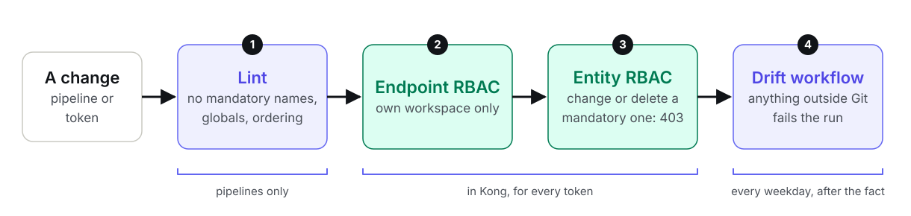
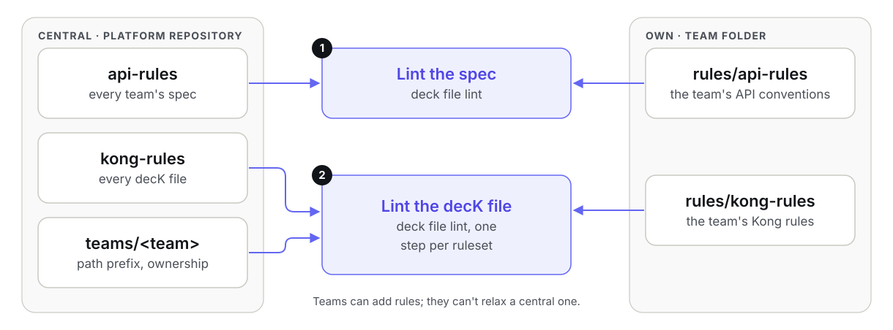
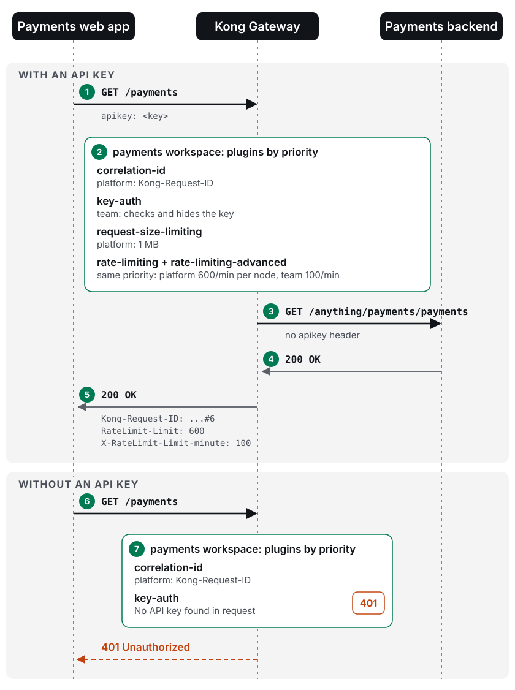

# The federation model

## Who owns what

| | Platform | API team |
|---|---|---|
| Workspaces, roles, pipeline users | owns | none |
| Mandatory plugins | owns | read only (`403` on change) |
| Central rulesets | owns | passes them |
| Services, routes, own plugins, own rulesets | reviews the rules | owns |
| People's access in Kong Manager | creates the roles; the IdP assigns them | read only (`workspace-read-only`) |
| Production | sets reviewers | merges; prod waits |

## What protects a mandatory plugin

Central rulesets run on every team; a team's own run as extra steps:

A call to a team's route runs the platform's plugins and the team's:

## Workspace per team or one shared workspace?

| | Workspace per team (this repo) | Shared workspace, tag per team |
|---|---|---|
| Isolation | RBAC on the Admin API | the pipeline only |
| Mandatory plugins | one copy per workspace | one copy |
| Good fit | two or more teams | one team |

## One repository or one per team?

In a federated model each team owns its repository: its spec, its plugins, its rules, its merges.
This repository keeps everything in one place so a single clone runs the whole model; treat
`teams/<team>/` as what each team's repository would hold.

| | One repo (`teams/<team>/`) | Repo per team (`examples/team-repo`) |
|---|---|---|
| Who merges | CODEOWNERS per folder | the team |
| Central rule changes | reach teams at once | when the team bumps `platform-ref` |
| Drift check | the platform's drift workflow | the team's scheduled run |
| Good fit | a pilot, or a few teams | federation at scale |

Both use the same reusable workflow, so a team moves without changing its files.

## Split a team into its own repository

1. **Platform repository:** keep `platform/`, `teams.yaml`, `.github/` and the central rulesets.
   Tag a release (`v1.0.0`). If it's private, set its Actions **Access** policy to allow the team
   repositories ([GitHub: access to reusable workflows](https://docs.github.com/en/actions/reference/workflows-and-actions/reusing-workflow-configurations)).
2. **`teams.yaml`:** add `repository: <org>/<repo>` to the team. Terraform still creates its
   workspace and pipeline token; CI and drift here skip it.
3. **Team repository:** move `teams/<team>/*` to its root and copy
   `examples/team-repo/.github/workflows/deploy.yaml`. Set `team`, `platform-repository` and
   `platform-ref` to the release tag.
4. **Settings** in the team repository: the `dev`, `prod` and `prod-drift` environments with the
   team's values ([production.md, GitHub settings](production.md#github-settings)), and the
   repository variable `KONG_ENABLED=true`. Give `prod` the platform team as required reviewers.
   If the platform repository is private, add `REPO_READ_TOKEN`: a fine-grained token with access
   to the platform repository only and **Contents: read-only**. The built-in token is
   ["limited to the repository that contains your workflow"](https://docs.github.com/en/actions/concepts/security/github_token),
   so it reads the team repository but not the platform's.
5. **Remove** `teams/<team>/` here. The team's workflow now runs plan on pull requests, deploy on
   merge and drift every weekday.

The platform keeps control through the pinned workflow and rulesets: a team changes its files, not
the pipeline. The platform's own CI reads `teams/payments/` and
`platform/governance/teams/payments.yaml` as test input (`ci.yaml`): keep `teams/payments/` here,
or point `ci.yaml` at a copy under `tests/fixtures/`.

## One repository per environment?

No. The same files go to dev and prod; addresses and tokens live in the `dev` and `prod` GitHub
environments ([settings](production.md#github-settings)), and `environments/<env>.yaml` holds the
few values that differ.
